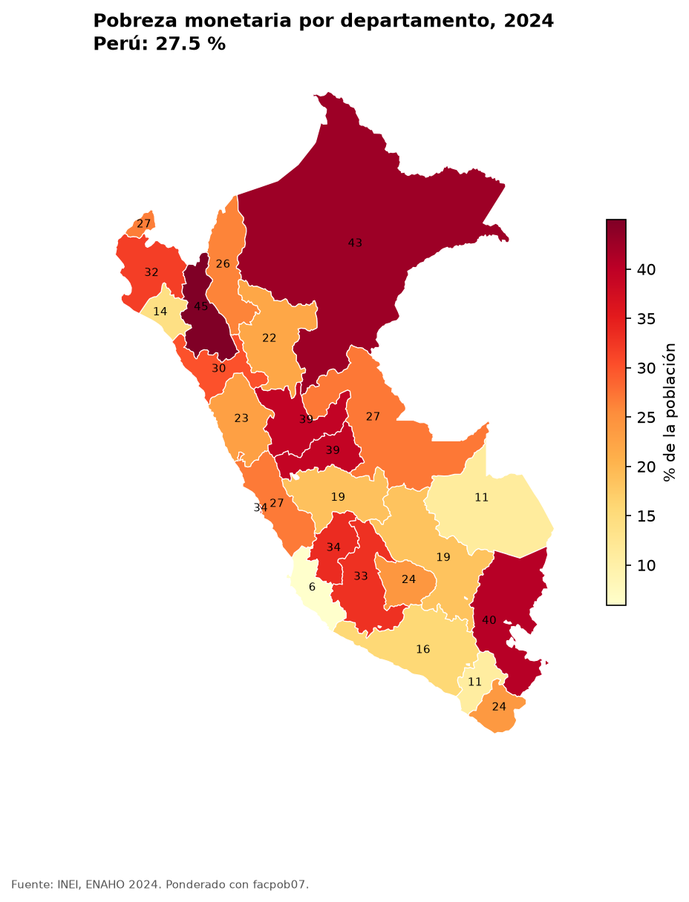

# ENAHO skills

Cuatro skills de Claude Code para estimar la pobreza monetaria del Perú con la ENAHO 2024
del INEI. Cada una hace una cosa y le pasa su salida a la siguiente:

| Skill | Entra | Sale |
|---|---|---|
| `descargando-enaho` | año (por defecto 2024) | `datos/sumaria-2024.dta`, `datos/enaho01-2024-200.dta`, `datos/peru_departamental.geojson` |
| `limpiando-enaho` | los dos `.dta` | `salidas/personas_2024.parquet`, `salidas/validacion.txt` |
| `graficando-enaho` | la base limpia y una pregunta | `figuras/*.png` |
| `mapeando-enaho` | la base limpia y el GeoJSON | `mapas/pobreza_departamento.png` |

Se encadenan solas: si falta la base limpia, graficar y mapear piden primero
`limpiando-enaho`; si faltan los `.dta`, limpiar pide primero `descargando-enaho`.



## Uso

```bash
uv sync
claude
```

Luego pide en lenguaje natural, por ejemplo *"¿Cuál fue la pobreza en Cusco en 2024?"*,
o llama una skill a mano: `/limpiando-enaho 2024`.

También puedes correr los scripts sin Claude:

```bash
uv run python .claude/skills/descargando-enaho/scripts/descargar.py --anio 2024
uv run python .claude/skills/limpiando-enaho/scripts/limpiar.py --anio 2024
uv run python .claude/skills/graficando-enaho/scripts/graficar.py --por area sexo grupo_edad departamento
uv run python .claude/skills/mapeando-enaho/scripts/mapear.py
```

## Datos

- Módulo 34, Sumaria: `966-Modulo34.zip`, una fila por hogar (33 691), factor `factor07`.
- Módulo 02, Miembros del hogar: `966-Modulo02.zip`, una fila por persona (117 721), factor `facpob07`.
- Límites departamentales: [juaneladio/peru-geojson](https://github.com/juaneladio/peru-geojson).

Los `.dta` no se suben al repositorio; se descargan de
`proyectos.inei.gob.pe/iinei/srienaho/descarga/STATA/`.

## Seis trampas que la limpieza resuelve

1. **Ceros a la izquierda:** `conglome`, `ubigeo` y demás llaves se guardan como texto.
2. **Nombres rotos:** `aÑo` pasa a `anio`; todos los nombres van en minúsculas y sin tildes.
3. **No todos son residentes:** de 117 721 filas quedan 108 664 residentes habituales.
4. **Uniones que duplican:** la unión persona → hogar usa `validate="m:1"`.
5. **Encuestas no son personas:** todo se pondera; la población expandida es de 34,1 millones.
6. **Códigos, no números:** pobre es `pobreza <= 2`, nunca un promedio de `pobreza`.

## Validación

`salidas/validacion.txt` (todo OK):

| Chequeo | Resultado | Esperado |
|---|---|---|
| Hogares en sumaria | 33 691 | 33 691 |
| Filas en módulo 200 | 117 721 | 117 721 |
| Residentes habituales | 108 664 | 108 664 |
| Duplicados / personas sin hogar | 0 / 0 | 0 / 0 |
| Pobreza, sumaria (`factor07 × mieperho`) | **27,6 %** | 27,6 % (cifra oficial INEI) |
| Pobreza, personas (`facpob07`) | 27,5 % | ±0,15 |

Los gráficos y el mapa usan `facpob07`, por eso muestran 27,5 % como total nacional.

## Resultados

| Corte | Pobreza |
|---|---|
| Urbano / Rural | 24,7 % / 39,4 % |
| Hombre / Mujer | 27,4 % / 27,7 % |
| 0–13 años | 38,0 % |
| Departamento más alto | Cajamarca, 45,0 % |
| Departamento más bajo | Ica, 5,9 % |

## Evaluación: tres pedidos con y sin skills

| Pedido | Con skills | Sin skills |
|---|---|---|
| "¿Cuál fue la pobreza en el Perú en 2024?" | 27,6 %, validado | _por completar_ |
| "Compara la pobreza urbana y rural" | 24,7 % vs 39,4 %, ponderado | _por completar_ |
| "Haz un mapa de pobreza por departamento" | mapa unido por código, 25 de 25 | _por completar_ |

Para la columna "sin skills", abre Claude Code en una carpeta con solo los `.dta` y haz los
mismos pedidos. Revisa si aparece alguna de las seis trampas.

## Requisitos

- [uv](https://docs.astral.sh/uv/) (Python 3.12, pandas, pyarrow, geopandas, matplotlib, truststore).
- `truststore` hace falta porque el servidor del INEI no envía su certificado intermedio; con él,
  Python usa los certificados de Windows y la verificación SSL sigue activa.
- En Windows, clona el repositorio en una ruta corta: con rutas muy largas no cargan las DLL de geopandas.
